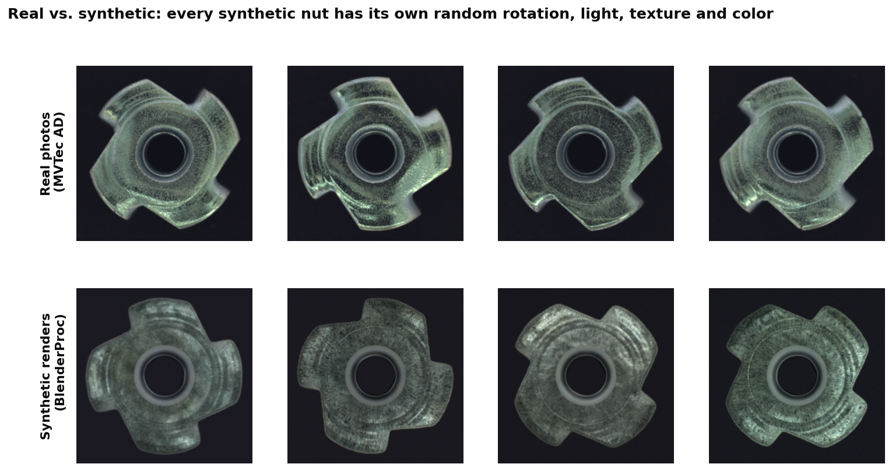
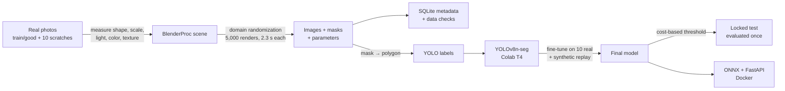
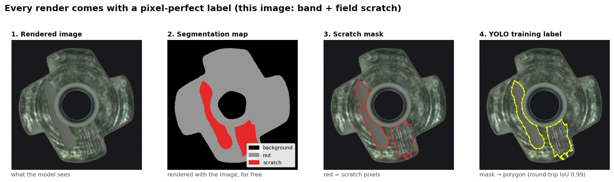
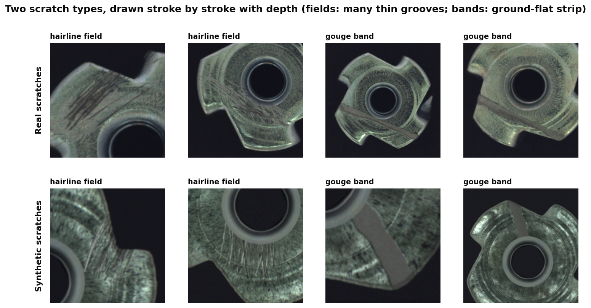
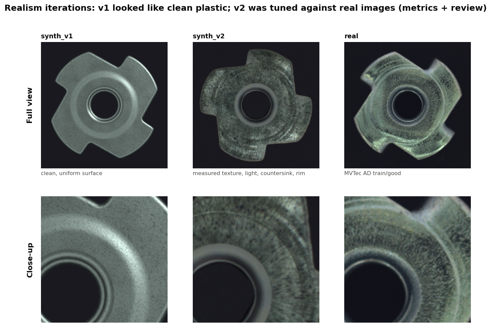
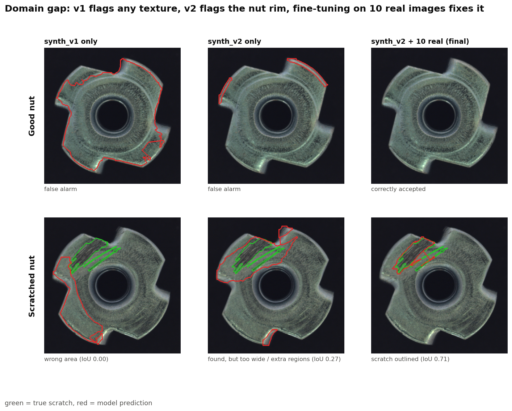
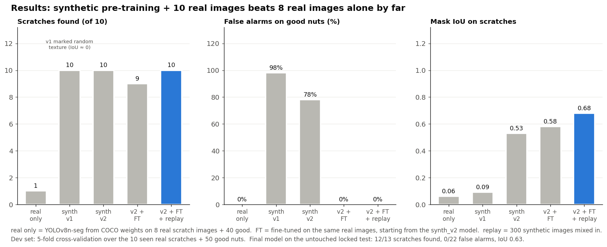
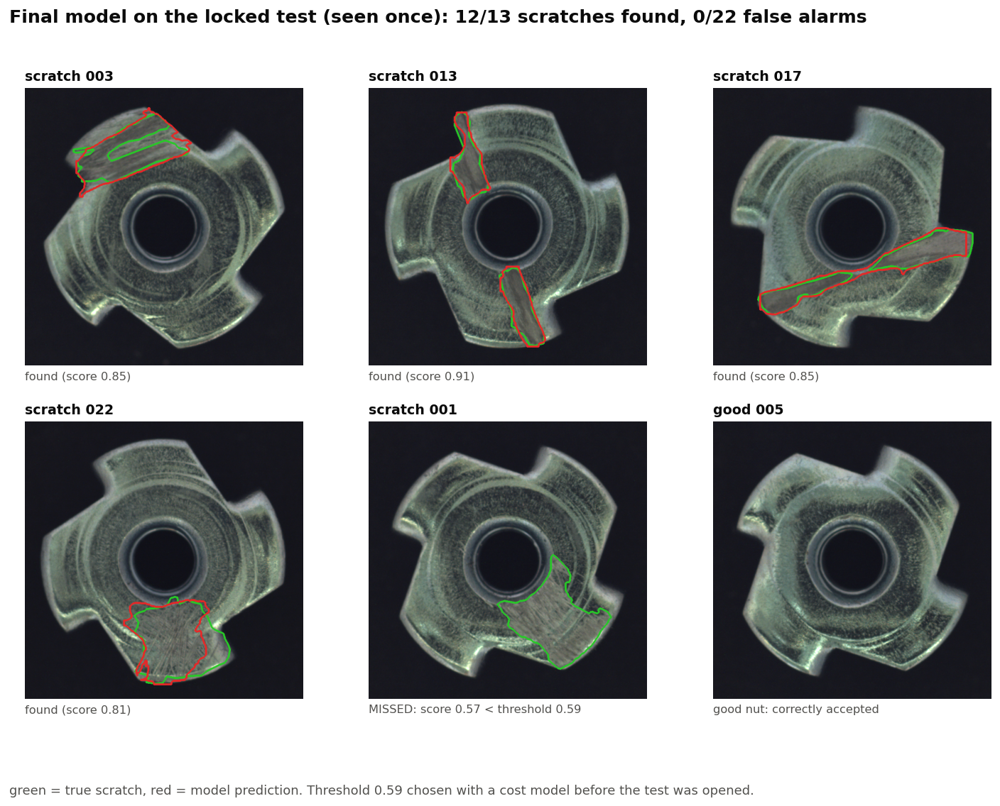

# Synthetic Data Factory: sim-to-real scratch segmentation

Industrial defect data is rare. This project trains a scratch segmentation model for metal
nuts almost entirely on **synthetic images rendered in Blender**, then adds just **10 real
images**, and measures what that buys on real photos (MVTec AD `metal_nut`).

| | Scratches found | False alarms on good nuts | Mask IoU |
|---|---|---|---|
| YOLOv8n-seg on 8 real images only (cross-validated) | 1 / 10 | 0% | 0.06 |
| **Synthetic pre-training + the same few real images** (cross-validated) | **10 / 10** | **0%** | **0.68** |
| **Final model on the untouched locked test (evaluated once)** | **12 / 13** | **0 / 22** | **0.63** |



**Stack:** BlenderProc (Blender 4.2) · Python, NumPy, OpenCV · PyTorch, Ultralytics YOLOv8-seg ·
SQLite · ONNX Runtime · FastAPI · Docker · Google Colab (T4)

---

## Why

A factory line produces thousands of good parts for every scratched one. MVTec AD has only
23 real scratch images for this part; 13 are locked away as the final test, which leaves
**10** to learn from. A segmentation model trained on 8 of them finds only 1 of the 10
held-out scratches across 5 cross-validation folds (10% recall). Labeling thousands of real defects by hand is slow and
expensive. Rendering them is cheap, and every render comes with a perfect label.

## Pipeline



## 1. Measure the real part first

Before rendering anything, the real images were measured (train/good and the 10 seen
scratches only, never the locked test). The synthetic nut is built from these numbers,
not from guesses:

- **Shape:** polar outline r(θ) of the nut averaged over 80 tabs (20 images × 4) →
  [render/nut_profile.json](render/nut_profile.json). This also fixes the tab handedness
  (a mirrored nut is a separate MVTec defect class, "flip").
- **Camera and scale:** nut centered within 2.5 px, diameter 623 ± 2.5 px → fixed camera,
  89% fill.
- **Light:** brightness around the flat ring vs angle shows a weak light from ~10 o'clock,
  fixed relative to the camera.
- **Color, texture, scratch size:** mean color, brightness spread, a radial brightness
  profile, scratch area 2-12% of the image.

Notes: [reports/analysis/real_observations.md](reports/analysis/real_observations.md).

## 2. Render synthetic data

[render/generate.py](render/generate.py) builds the scene once and changes only the
parameters per image (1 Blender process, ~2.3 s per 512 px image on an M1 Pro, 64 samples
+ denoiser). Every image's parameters are logged, and image *i* is reproducible from seed
`[seed, i]`.

**Domain randomization:** rotation, small camera tilt, ring light + 6 random lamps,
surface texture (color-only "iris" strokes, mottling, gold specks), roughness, white
balance, depth of field (prongs bend away from the focal plane), sensor noise and
chromatic aberration, background shade. 35% of images have no scratch, the rest 1-3.

Every render comes with its label for free: the segmentation map is rendered together
with the image, converted to YOLO polygons, and the conversion is checked by drawing the
polygons back (round-trip IoU 0.99).



**Scratches** are drawn stroke by stroke into a texture in the nut's own coordinates:
hairline fields (15-60 thin crossing grooves) and gouge bands (a ground-flat strip with
pointed ends). They carry depth (a bump from the stroke height map), so groove walls catch
the light. The mask comes from the same strokes, so image and label always agree.



## 3. Realism matters (and how to measure it)

The first dataset (`synth_v1`, git tag `synth_v1`) matched the real images on mean color,
size and fine grain, but looked like clean plastic. A model trained on it flagged
**98% of real good nuts**: it had learned "any texture = scratch".

`synth_v2` was tuned against real images with new metrics (mid-scale shading, brightness
spread, radial profile, scratch contrast) and several rounds of annotated visual review.
A user rating of 16 renders was matched to the logged parameters to narrow the random
ranges.



With v2 the model finds the real scratches themselves (IoU 0.53 instead of 0.09), but it
still flags the nut rim on good parts: 81% of its false alarms lie almost entirely in
the outer ring. That
pointed the next step at the rim, not at the surface texture where most tuning time had
gone. Fine-tuning on the 10 real images then removed these false alarms.



## 4. Few-shot fine-tuning and a leakage-safe evaluation

- **Split first.** [tools/make_split.py](tools/make_split.py) (seed 0) puts 13 scratch + 22
  good test images in a locked set on day 0. Nothing was tuned on it, and the evaluation
  tools refuse to read it.
- **Cross-validation on the rest.** 5 folds over the 10 seen scratches: each model trains
  on 8 (+ 40 good) and is tested on the other 2 (+ 50 good). All variants use the same
  folds, fixed hyperparameters, and the last epoch's weights. (A first version picked
  `best.pt` by a validation score computed on the fold's test images. That is leakage; it
  was caught and fixed.)
- **Variants** ([train/fewshot_cv.py](train/fewshot_cv.py)): real only (COCO weights),
  synthetic only, synthetic + fine-tune, synthetic + fine-tune + 300 synthetic images mixed
  in (replay, against catastrophic forgetting).
- **Threshold from a cost model.** Out-of-fold scores of the cross-validation models on the
  held-out scratches and 180 unused good nuts; expected cost per part with stated
  assumptions (5% defect rate, a missed scratch costs 5×/20×/50× a false alarm) →
  threshold 0.59, fixed before the locked test was opened
  ([tools/cost_threshold.py](tools/cost_threshold.py)).



## 5. Final result

The final model (synthetic pre-training + all 10 real scratches + 40 good + replay) was
evaluated **once** on the locked test at threshold 0.59:
**12/13 scratches found, 0/22 false alarms, precision 100%, mean mask IoU 0.63.**
The missed scratch scored 0.57, just below the threshold. It stays missed: the threshold
was not changed after seeing the test.



## 6. Serving

The model is exported to ONNX and served by FastAPI. The container runs on ONNX Runtime
with NumPy post-processing (letterbox, NMS, mask decoding), no PyTorch: the image is
583 MB. Against the PyTorch model on 40 real images: same decision 40/40, mask IoU 0.97,
~42 ms per image on a laptop CPU ([tools/check_onnx_parity.py](tools/check_onnx_parity.py)).

```bash
docker build -t scratch-api -f serve/Dockerfile serve
docker run --rm -p 8000:8000 scratch-api
# interactive docs: http://localhost:8000/docs
curl -F "file=@nut.png" localhost:8000/predict
```

```json
{"decision": "reject", "best_score": 0.91, "threshold": 0.59, "n_regions": 1,
 "scratch_area_pct": 6.229, "regions": [{"score": 0.91, "box": [65, 319, 466, 559], "area_px": 30521}],
 "image_size": [700, 700], "inference_ms": 191.4}
```

`POST /predict/overlay` returns the image with the scratch outlined. Tests:
`python -m pytest serve/test_app.py`.

## Lessons learned

- **A matching metric is not proof of realism.** v1 matched mean color and fine grain and
  still caused 98% false alarms. Check by eye, then find the metric's blind spot.
- **Let the model's errors choose the next fix.** Most tuning went into surface texture;
  the remaining false alarms were on the rim.
- **Look at the renders, not only the masks.** Two invisible bugs only showed up in images:
  the flat body hid most of the countersink, and Cycles cached the scratch texture after
  the first frame (every scratch rendered invisible while its mask was correct).
- **Leakage hides in model selection.** Choosing `best.pt` by a score on test images
  inflated recall from 1/10 to 2/10 in the real-only baseline.

## Limitations and next steps

- The test set is small (13 scratches): one image moves recall by ~8 points.
- Only scratches; MVTec's other metal_nut defects (bent, color, flip) are not modeled.
- The model is valid for the measured camera setup. Planned: a **robustness test** with
  out-of-distribution renders (camera tilt, nut color, light) to find where it breaks.
- Planned: an **ablation** of the randomization groups (light / material / camera) with
  `render/generate.py --rand`.

## Repository layout

```
render/      generate.py (BlenderProc scene, randomization, scratches, masks), nut_profile.json
tools/       measurements, data checks, YOLO conversion, evaluation, threshold, figures, ONNX
train/       Colab notebook, few-shot cross-validation / final training
serve/       FastAPI app, ONNX inference, Dockerfile, tests, model.onnx
db/          SQLite schema + data-check queries
splits/      seen_pool.txt (10 scratches) and locked_test.txt (13 scratch + 22 good)
reports/     figures/ (this README), analysis/ (measurements, data stats), results/ (all metrics)
PROGRESS.md  day-by-day log of every step, decision and number
```

## Reproduce

```bash
pip install -r requirements.txt
python tools/make_split.py                                   # day 0: seen pool / locked test
python tools/nut_profile.py && python tools/light_direction.py
blenderproc run render/generate.py --n 5000 --seed 0 --out data/synth/synth_v2 --version synth_v2
python tools/build_db.py data/synth/synth_v2 --db db/meta_v2.sqlite
python tools/data_stats.py --db db/meta_v2.sqlite --out reports/analysis/data_stats_v2.md
python tools/mask_to_yolo.py synth --db db/meta_v2.sqlite --out data/yolo/synth_v2
python tools/mask_to_yolo.py real --out data/yolo/real
# train/train_colab.ipynb (DATASET = 'synth_v2') -> output/models/synth_v2_best.pt
python train/fewshot_cv.py --name v2_ft_replay --init output/models/synth_v2_best.pt \
    --epochs 30 --lr0 0.001 --synth data/yolo/synth_v2 --n-synth 300
python tools/cost_threshold.py --name v2_ft_replay
python train/fewshot_cv.py --name v2_ft_replay --init output/models/synth_v2_best.pt \
    --epochs 30 --lr0 0.001 --synth data/yolo/synth_v2 --n-synth 300 --final
python tools/final_eval.py --model output/models/final_v2_ft_replay.pt --threshold 0.59 \
    --i-confirm-final-evaluation                             # once
python tools/export_onnx.py && python tools/make_figures.py
```

## Data and license

Code: [MIT](LICENSE).
Real images: [MVTec AD](https://www.mvtec.com/company/research/datasets/mvtec-ad)
(`metal_nut`), licensed CC BY-NC-SA 4.0. The dataset is not included in this repository;
the figures show a few MVTec images for illustration only.
