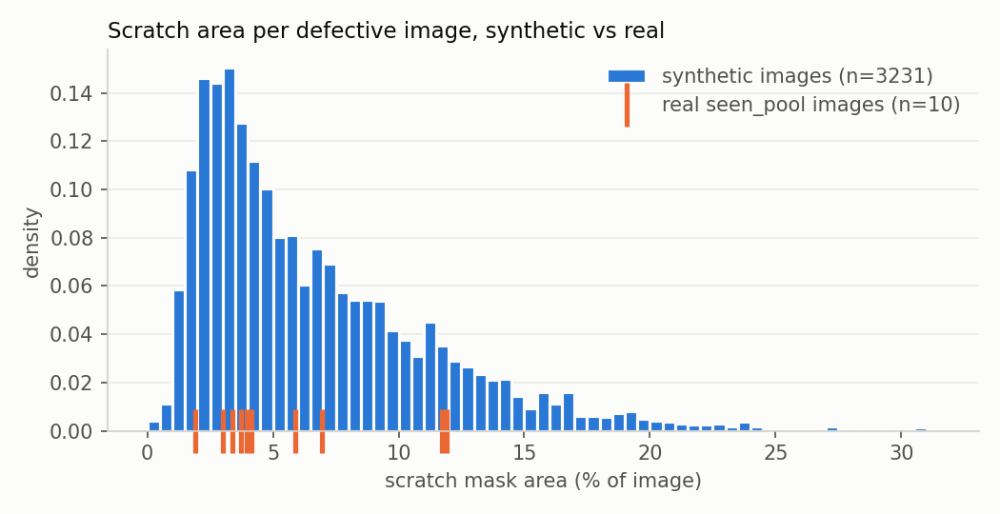
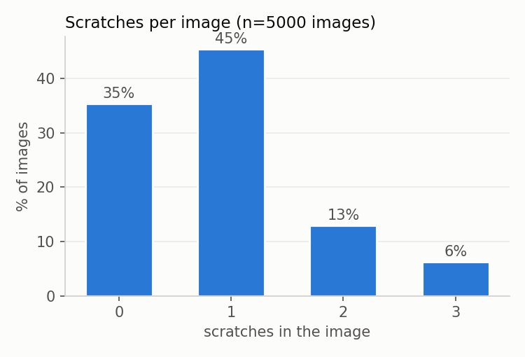

# Synthetic data statistics

Dataset: synth_v1, 5000 images. Generated by `tools/data_stats.py` from
`db/meta.sqlite` (queries: `db/checks.sql`).

### 1. Split balance
Are train and val similar? Same defect-free share and same scratches per image.

| split | images | pct_defect_free | avg_scratches |
|---|---|---|---|
| train | 4500 | 35.2 | 0.91 |
| val | 500 | 36.8 | 0.86 |

### 2. Defective vs defect-free
Target: 30-40% defect-free (roadmap); generator draws 35%.

| n_defects | images | pct |
|---|---|---|
| 0 | 1769 | 35.4 |
| 1 | 2271 | 45.4 |
| 2 | 648 | 13.0 |
| 3 | 312 | 6.2 |

### 3. Scratch area distribution by type
Visible mask area as % of the 512x512 image. Real seen_pool: 1.9-11.9%, median ~4%.

| type | scratches | min_pct | avg_pct | max_pct |
|---|---|---|---|---|
| band | 1367 | 0.88 | 3.02 | 6.27 |
| field | 3136 | 0.07 | 5.48 | 18.01 |

### 4. Empty or tiny masks
A scratch drawn mostly over the hole/background leaves few or no mask pixels. Such labels are noise: the image "has a scratch" but almost nothing to see.

| mask_size | scratches |
|---|---|
| ok (>=200 px) | 4502 |
| tiny (<200 px) | 1 |

### 5. Parameter coverage
Do the random parameters cover their full intended ranges?

| parameter | min | max | avg |
|---|---|---|---|
| rotation_deg | 0.2 | 359.96 | 178.78 |
| ring_strength | 0.263 | 0.455 | 0.359 |
| key_energy | 0.02 | 30.0 | 14.82 |
| cam_tilt_deg | 0.0 | 3.0 | 1.5 |
| scratch_darken | 0.35 | 0.7 | 0.524 |
| scratch_roughness | 0.55 | 0.85 | 0.701 |

### Histograms

Total scratch area per defective image. Real reference = the 10 seen_pool
scratch masks (700x700, area as % of image),
median 4.0%, range 1.9-11.9%.
Synthetic median 5.2%.

