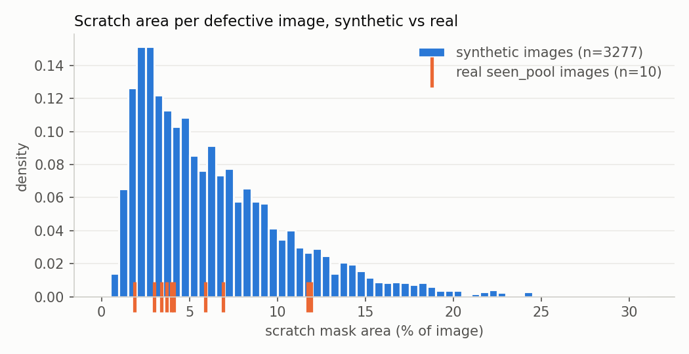
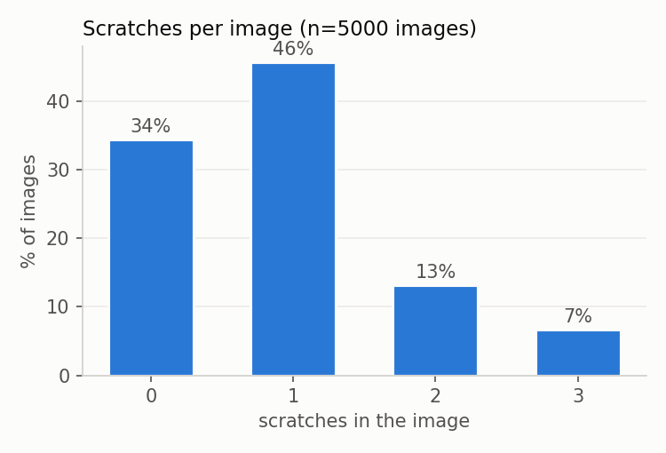

# Synthetic data statistics

Dataset: synth_v2, 5000 images. Generated by `tools/data_stats.py` from
`db/meta_v2.sqlite` (queries: `db/checks.sql`).

### 1. Split balance
Are train and val similar? Same defect-free share and same scratches per image.

| split | images | pct_defect_free | avg_scratches |
|---|---|---|---|
| train | 4500 | 34.2 | 0.92 |
| val | 500 | 37.2 | 0.9 |

### 2. Defective vs defect-free
Target: 30-40% defect-free (roadmap); generator draws 35%.

| n_defects | images | pct |
|---|---|---|
| 0 | 1723 | 34.5 |
| 1 | 2287 | 45.7 |
| 2 | 657 | 13.1 |
| 3 | 333 | 6.7 |

### 3. Scratch area distribution by type
Visible mask area as % of the 512x512 image. Real seen_pool: 1.9-11.9%, median ~4%.

| type | scratches | min_pct | avg_pct | max_pct |
|---|---|---|---|---|
| band | 1373 | 0.73 | 2.9 | 7.12 |
| field | 3227 | 0.31 | 5.27 | 16.31 |

### 4. Empty or tiny masks
A scratch drawn mostly over the hole/background leaves few or no mask pixels. Such labels are noise: the image "has a scratch" but almost nothing to see.

| mask_size | scratches |
|---|---|
| ok (>=200 px) | 4600 |

### 5. Parameter coverage
Do the random parameters cover their full intended ranges?

| parameter | min | max | avg |
|---|---|---|---|
| rotation_deg | 0.2 | 359.96 | 178.78 |
| ring_strength | 0.15 | 0.26 | 0.204 |
| key_energy | 0.0 | 23.99 | 11.95 |
| cam_tilt_deg | 0.0 | 3.0 | 1.5 |
| scratch_darken | None | None | None |
| scratch_roughness | 0.35 | 0.55 | 0.45 |

### Histograms

Total scratch area per defective image. Real reference = the 10 seen_pool
scratch masks (700x700, area as % of image),
median 4.0%, range 1.9-11.9%.
Synthetic median 5.2%.

